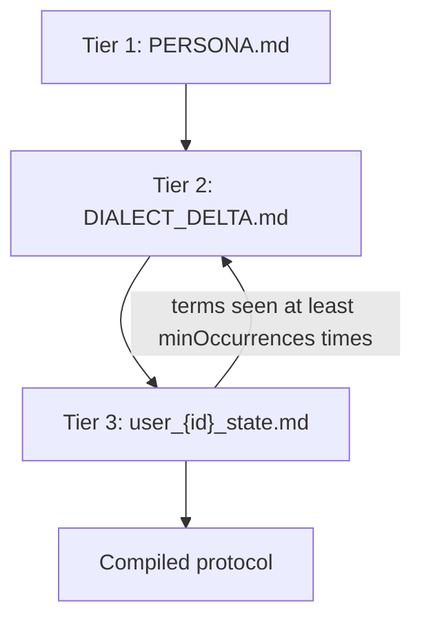

# persona-mcp

Local-first, Markdown-driven persona engine for AI agents: a TypeScript SDK and an MCP stdio server.

[](https://github.com/sc-lacanlale/Persona/actions/workflows/ci.yml)

## Demo

TODO: add a short GIF of Claude Desktop or Cursor calling `process_user_turn` and showing the compiled protocol. No image is linked here until that recording exists.

## Why it exists

Model instructions and a person's working vocabulary change at different speeds. A base persona (how this agent builds UI, what it refuses, how terse it is) should stay put. Repeated slang and project idioms should be allowed to accumulate. Per-user context should not be copied into the shared persona.

persona-mcp keeps those as three markdown files on disk. The engine reads them, appends the latest turn to the user profile, and returns one protocol string the caller can put in front of a model. Nothing in the core path makes a network call.

## Three tiers



| Tier | File                                    | Role                                                                             |
| ---- | --------------------------------------- | -------------------------------------------------------------------------------- |
| 1    | `data/personas/<name>/PERSONA.md`       | Stable instructions. Required.                                                   |
| 2    | `data/personas/<name>/DIALECT_DELTA.md` | Terms promoted out of user profiles. Created on first read if missing.           |
| 3    | `data/profiles/user_<id>_state.md`      | Last few turns and unmapped candidate terms for one user. Created on first turn. |

On each turn the engine stacks all three into a single markdown protocol with `## Tier 1 Core Persona`, `## Tier 2 Dialect Delta`, and `## Tier 3 User State`. `run_evolution_cycle` scans profiles, and when a term's combined occurrences reach the threshold (default 2) it appends one `## Accepted Term` block to that persona's dialect file. A term already listed there is removed from the profiles and is not written again.

A promoted block looks like this:

```markdown
## Accepted Term

- term: slay | sourceType: text | recurrence: 2 | context: Make the login button slay.
```

The sample persona is `data/personas/frontend-react-architect/`. Its dialect file starts empty on purpose. `data/profiles/user_dev_project_1_state.md` is a sample profile, not the output of a test run.

## Requirements

- Node.js 22 or newer
- npm

## Install

```bash
git clone https://github.com/sc-lacanlale/Persona.git
cd Persona
npm ci
npm run build
```

Add a persona by creating `data/personas/<personaName>/PERSONA.md`. `DIALECT_DELTA.md` is created the first time that persona is read.

## MCP client config

Build first. The stdio entrypoint is `dist/interfaces/mcp/stdioServer.js`. stdout is JSON-RPC only; startup and errors go to stderr.

`PERSONA_BASE_DIR` is the directory that contains `data/`. If you omit it, the server uses its working directory.

Claude Desktop reads `claude_desktop_config.json` (Settings → Developer → Edit Config). Cursor reads `.cursor/mcp.json`. Both use the same shape. Replace the two paths.

```json
{
  "mcpServers": {
    "persona-mcp": {
      "command": "node",
      "args": ["/ABSOLUTE/PATH/TO/Persona/dist/interfaces/mcp/stdioServer.js"],
      "env": {
        "PERSONA_BASE_DIR": "/ABSOLUTE/PATH/TO/Persona"
      }
    }
  }
}
```

## SDK

The package is not on npm (`"private": true` in `package.json`). After `npm run build`, this works from the repo root and writes `data/profiles/user_dev_project_1_state.md`:

```bash
node --input-type=module -e "
import { PersonaEngine } from './dist/index.js';
const engine = new PersonaEngine({ baseDir: process.cwd() });
const result = await engine.processUserTurn('dev_project_1', 'Make the login button slay.', 'frontend-react-architect');
console.log(result.systemInstruction);
"
```

The same API from a module that imports the build:

```ts
import { PersonaEngine, runEvolutionCycle } from "./dist/index.js";

const engine = new PersonaEngine({ baseDir: process.cwd() });

const result = await engine.processUserTurn(
  "dev_project_1",
  "Make the login button slay.",
  "frontend-react-architect",
);

console.log(result.systemInstruction);
console.log(result.profileMetadata);

const report = await runEvolutionCycle({ baseDir: process.cwd(), minOccurrences: 2 });
console.log(report);
```

After a release, the import is `persona-mcp`. The name is not on the registry yet, and this repo does not publish it.

## Tools

| Tool                  | What it does                                                                                                      | Arguments                                                |
| --------------------- | ----------------------------------------------------------------------------------------------------------------- | -------------------------------------------------------- |
| `process_user_turn`   | Records the turn and returns the compiled protocol.                                                               | `userId`, `userMessage`, `personaName`                   |
| `harvest_idiom_delta` | Queues one term on a profile. `context` defaults to `manual`. `sourceType` defaults to `text` (`text` or `code`). | `userId`, `personaName`, `term`, `context`, `sourceType` |
| `read_dialect_delta`  | Returns `DIALECT_DELTA.md` for a persona.                                                                         | `personaName`                                            |
| `run_evolution_cycle` | Promotes recurring terms. `minOccurrences` defaults to `2`.                                                       | `minOccurrences`                                         |

The same compile step is also registered as the prompt `get_adaptive_persona` (`userId`, `userMessage`, `personaName`). `DIALECT_DELTA.md` is also exposed as the resource `persona://archetypes/{personaName}`.

A missing `PERSONA.md` comes back as a tool error (`isError: true`) whose text includes the missing path. `process_user_turn` and `harvest_idiom_delta` write profile files. `run_evolution_cycle` writes dialect files.

## Development

```bash
npm ci
npm run lint
npm run format:check
npm run typecheck
npm test
npm run build
npm run mcp:stdio
```

`npm test` runs Vitest. Unit tests cover `markdownLoader` (path segments, profile round-trip, atomic write), `detector` (known terms and repeated tokens), and `evolution` (cross-profile dedupe, skip-if-already-accepted, threshold). The stdio integration test builds `dist/`, spawns `stdioServer.js`, and uses `@modelcontextprotocol/client` to initialize, list tools, and call each tool.

Lint is ESLint (typescript-eslint, type-checked) and Prettier.

CI on push and pull request runs install, lint, format check, typecheck, test, and build (`.github/workflows/ci.yml`).

### Release

This package is unpublished. The release workflow (`.github/workflows/release.yml`) runs on tags `vX.Y.Z`. It refuses to publish unless the `NPM_TOKEN` repository secret is set, and it refuses while `private` is `true`. Set `private` to `false`, add `NPM_TOKEN`, then tag. The workflow publishes with `npm publish --access public --provenance`.

Older commits still contain a generated `dist/` and empty `mcp.stderr.log` / `mcp.stdout.log`. Those paths are gitignored now. History was not rewritten.

## Stack

TypeScript, Node.js 22, Zod 4, Vitest, ESLint, Prettier. MCP SDK v2: `@modelcontextprotocol/server` and `@modelcontextprotocol/client` 2.3.1, which replace `@modelcontextprotocol/sdk`.

## Limitations

- The candidate detector is a lexical scan. A token matches `[A-Za-z][A-Za-z0-9_-]{2,}` (at least 3 characters). It does not know which words are slang. Ordinary words are promoted once they hit `minOccurrences`.
- Files stay on the machine running the server. There is no sync.
- Candidate fields are stored in one pipe-delimited line. Newlines and `|` in a term or context are stored as spaces and `/`.
- There is no published npm package and no demo recording yet.

## License

MIT. Copyright (c) 2026 Shanley Clarence Lacanlale. See [LICENSE.md](LICENSE.md).
